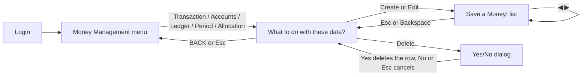

# Save a Money! — Knowledge Transfer

This document explains how the "Save a Money!" money-management app is built: the frontend, the Supabase backend, how the two connect, and how to change or extend them. The visual design is based on a set of 1920×1080 mockups in a Persona-style menu aesthetic.

The app tracks a monthly budget that originally lived in a spreadsheet (`Financial Management.xlsx`): salary is split into **funds**, expenses are charged to a fund, spending from the savings fund is tracked as a **ledger** that is repaid later, and two real banks (savings and spending) should always match the numbers on screen.

---

## 1. Quick start

Requirements: Node.js 18+, npm, and a Supabase project.

```bash
cd save-a-money-menu
npm install
cp .env.example .env.local   # fill in VITE_SUPABASE_URL and VITE_SUPABASE_ANON_KEY
npm run dev        # dev server, usually http://localhost:5173
npm run build      # production build into dist/
npm run preview    # serve the production build locally
```

Then apply the database migrations in `supabase/migrations/` (section 4) and create a user in Supabase Auth (Authentication → Users). Without `.env.local` the app shows a "Setup needed" page.

## 2. Tech stack

| Tool                                         | Purpose                                                                  |
| -------------------------------------------- | ------------------------------------------------------------------------ |
| React 18                                     | UI and screen state                                                      |
| Vite 6                                       | Dev server and bundler                                                   |
| Tailwind CSS 4 (via `@tailwindcss/vite`)     | Styling; configured in `src/index.css`, there is no `tailwind.config.js` |
| Supabase (`@supabase/supabase-js`)           | Postgres database, email/password auth, `pg_cron` for the monthly job    |
| Inter (Google Fonts, loaded in `index.html`) | The only typeface                                                        |

There is no router and no state library. Screen state lives in `App.jsx`; all data comes from Supabase through `src/lib/api.js`.

## 3. Project structure

```
save-a-money-menu/
├── index.html
├── package.json
├── vite.config.js
├── .env.example             # VITE_SUPABASE_URL, VITE_SUPABASE_ANON_KEY
├── KNOWLEDGE_TRANSFER.md    # This file
├── public/images/           # Put background artwork here (section 10.1)
├── supabase/
│   ├── migrations/          # The schema, applied in filename order (section 4)
│   └── seed.sql             # Optional starter accounts
└── src/
    ├── main.jsx             # React entry point
    ├── App.jsx              # Auth gate, data loading, which screen is showing, save/delete
    ├── index.css            # Tailwind import, theme colours, sizing system, custom utilities
    ├── images.js            # Which picture each background slot shows (section 10.1)
    ├── lists.jsx            # Column/row/edit definitions for the seven lists (see section 8)
    ├── data.js              # Old static sample data, no longer used by the app
    ├── lib/
    │   ├── supabase.js      # Supabase client and `isConfigured`
    │   ├── api.js           # All reads and writes; converts between UI rows and database rows
    │   └── format.js        # Number, date and period parsing/formatting
    ├── hooks/
    │   ├── useKeys.js       # Global keyboard handler hook
    │   ├── useCursor.js     # useCursor (sliding row highlight) and useRail (scrollbar thumb)
    │   └── useSession.js    # Current Supabase auth session
    ├── components/
    │   ├── ConfirmDelete.jsx  # Yes/No delete dialog
    │   ├── EditCells.jsx      # Inline edit controls for one row
    │   ├── Floppy.jsx         # Save icon and "Saving..." overlay
    │   ├── ImageSlot.jsx      # The one background-image element (picture or placeholder)
    │   ├── RpBox.jsx          # Total real balance with the two banks underneath
    │   ├── Shape.jsx          # Background polygons, defined in mockup coordinates
    │   └── TrendArrow.jsx     # Blue income / red outcome arrow icon
    └── screens/
        ├── Login.jsx          # Email + password sign-in
        ├── MainMenu.jsx       # "Money Management" menu with six tabs
        ├── ActionScreen.jsx   # "What to do with these data?" page
        └── ListScreen.jsx     # "Save a Money!" list page with inline editing
```

## 4. Backend: database and migrations

Run the files in `supabase/migrations/` in order (Supabase CLI `supabase db push`, or paste them into the SQL editor). Enable the **`pg_cron`** extension first (Database → Extensions), or the last-but-one migration fails.

| Migration                                      | What it adds                                                                                                                           |
| ---------------------------------------------- | -------------------------------------------------------------------------------------------------------------------------------------- |
| `20261023000000_init.sql`                      | Base tables `periode`, `account`, `transaction`, `ledger`, plus row level security (signed-in users only)                              |
| `20261104000000_funds_and_allocation.sql`      | Account columns `opening_balance`, `is_fund`, `is_ledger_source`, `bank`, `feeds_account_id`; starter accounts; the `allocation` table |
| `20261104000100_planned_status_and_ledger.sql` | Transaction status `planned`/`completed` and `is_planned`; optional category; ledger status `partial`; duplicate guards                |
| `20261104000200_balance_views.sql`             | Views `account_balance` and `bank_balance`                                                                                             |
| `20261104000300_monthly_bank_entries.sql`      | `bank_policy` table, `run_monthly_bank_entries()` function, `pg_cron` schedule                                                         |
| `20261106000000_allocation_usage.sql`          | View `allocation_usage` (used amount per allocation)                                                                                   |
| `20261109000000_split_fund_and_category.sql`   | Split `account` into `fund` + `account`, add `category` table (see section 14)                                                         |

`seed.sql` is optional and only inserts four generic starter accounts.

### 4.1 How the spreadsheet maps to the database

| Spreadsheet                                                         | Database                                                                           |
| ------------------------------------------------------------------- | ---------------------------------------------------------------------------------- |
| Payroll Month ("October 2026")                                      | `periode` (`periode_month` + `periode_year`)                                       |
| Expense Source (Fixed Expense / Comfort / Saving / Repayment Funds) | `account` rows with `is_fund = true`                                               |
| Fixed Expense and Comfort Expense sheets                            | One `transaction` table; the fund is the transaction's `account_id`                |
| Status Planned / Done / blank                                       | `transaction_status` (`planned`/`completed`) plus `is_planned`                     |
| Ledger sheet                                                        | `ledger` row per transaction taken from the `is_ledger_source` fund (Saving Funds) |
| Master Sheet funds columns (I:L)                                    | `allocation` (one row per period per fund)                                         |
| Opening Balances                                                    | `account.opening_balance`                                                          |
| Saving Balance / Owed to Savings                                    | `account_balance` view and ledger rows                                             |

### 4.2 Key rules

- **Accounts** are either `income` (PSI Salary, DBklik Salary, Bank Interest) or `outcome` (the funds, Bank Admin Fee). `bank` is `savings` or `spending`.
- **Funds** (`is_fund`) get a balance. `is_ledger_source` marks the savings fund: spending from it is borrowed from savings and tracked in `ledger`.
- **Fund balance** = `opening_balance + allocated − spent + repaid + extra_in − extra_out`. `planned` transactions are committed but not yet spent, so "free" = balance − planned. This is the `account_balance` view.
- **Bank balances** (`bank_balance` view) are meant to match the real bank apps. Savings is the Saving Funds balance. Spending is opening balance + salary in − fund spending and the admin fee − money moved to savings − ledger repayments. If it does not match a bank app, an unrecorded transaction is the usual cause.
- **Planned vs unplanned:** `transaction_status` is `planned` or `completed`; `is_planned` stays `true` once a planned item is completed. A completed row with `is_planned = false` is an unplanned expense.
- **Ledger status** is `pending` (shown "Unpaid"), `partial` or `paid` (shown "Paid off"). `ledger.transaction_id` is unique.
- **Allocation usage** (`allocation_usage` view) = planned + completed transactions of that fund in that period, like the sheet's "Used" columns.

### 4.3 Monthly bank job

`run_monthly_bank_entries()` posts two completed transactions for the month, both with category `Auto: …` (a unique index stops duplicates):

- **Bank Interest** (income) on the Saving Funds balance: `balance × interest_rate_yearly / 12` (default 6% per year). It adds to Saving Funds through the account's `feeds_account_id`.
- **Bank Admin Fee** (outcome, default 10,000). It belongs to the spending bank only and does not reduce any fund, like the sheet where the fee comes off salary before the split.

`pg_cron` runs it at 23:00 Jakarta time (16:00 UTC) on days 28–31, and a `WHERE` clause lets it through only when tomorrow is the 1st. Change the fee or rate in the single `bank_policy` row (there is no screen for it yet). To test: `select run_monthly_bank_entries('2026-10-31');`. Do not run it for a month whose fee you already entered by hand, because a manual row has no `Auto:` category and will not be recognised as a duplicate.

### 4.4 Security

Row level security allows only signed-in (`authenticated`) users on every table. There is one user pool and no per-user ownership, so every signed-in user sees all data. The `init` migration mentions a Telegram bot that uses the service role key; it is not part of this repository. Views use `security_invoker`, so they follow the same rules.

## 5. Screen flow



- `App.jsx` shows `Login` until there is a session, then the app. It holds `screen` (`'main' | 'action' | 'list'`), `tab`, `list` (index into `LISTS`: 0 Transaction, 1 Account, 2 Ledger, 3 Period, 4 Allocation, 5 Fund, 6 Category) and `store`.
- `store[i]` holds the rows of `LISTS[i]`, loaded by `fetchAll()`. `banks` holds the real bank balances from `fetchBanks()`. Both reload after every save or delete.
- ◀ ▶ on the list screen change `list`, so going back opens the action screen for whichever section was last shown.
- The **Main** tab has no screen and does nothing when chosen.
- The main menu also has an **Effects: Full/Lite** toggle (saved in `localStorage`; it defaults to Lite when the OS asks for reduced motion) and **Sign out**.

### URL shortcuts (development aid)

| URL         | Opens                                 |
| ----------- | ------------------------------------- |
| `/#action`  | "What to do with these data?"         |
| `/#confirm` | Same page with the delete dialog open |
| `/#list`    | "Save a Money!" list                  |

They always open the Transaction section and still need a signed-in session.

## 6. Controls

| Screen                      | Mouse                                                                                                                      | Keyboard                                                           |
| --------------------------- | -------------------------------------------------------------------------------------------------------------------------- | ------------------------------------------------------------------ |
| Main menu                   | Hover highlights a tab, click opens it                                                                                     | ← → move, Enter opens                                              |
| What to do with these data? | Hover highlights a row; Create/Edit/Delete/BACK buttons                                                                    | ↑ ↓ move rows, Enter opens the list, Esc/Backspace back to menu    |
| Delete dialog               | Hover highlights, click chooses                                                                                            | ↑ ↓ toggle Yes/No, Enter confirms, Esc cancels                     |
| Save a Money! list          | Hover highlights a row; click shows an Edit button; double-click edits; **+** adds a row; floppy saves; ◀ ▶ switch section | ← → switch section, ↑ ↓ move rows, Enter edits, Esc/Backspace back |
| Editing a row               | Type in the cells                                                                                                          | Enter saves, Esc cancels                                           |

`useKeys` lets inputs and selects keep Backspace and the arrow keys, so typing works in edit cells.

## 7. Sizing and responsive system (read this before changing layout)

### 7.1 The `u` unit

All measurements in the code are **pixels of the original 1920×1080 mockup**. They are converted to real pixels through one CSS variable defined in `src/index.css`:

```css
--u: clamp(0.5px, min(calc(100vw / 1920), calc(100dvh / 1080)), 2.5px);
```

- `1u` is one mockup pixel, scaled by the **smaller** of window width and height. Text and boxes therefore never stretch out of proportion.
- It is clamped between 0.5px and 2.5px, so text stays readable on phones and doesn't become huge on 4K screens.

Tailwind's spacing scale is set to this unit (`--spacing: var(--u)`), so **every numeric spacing utility is in mockup pixels**:

| Class                                            | Means                                  |
| ------------------------------------------------ | -------------------------------------- |
| `w-278`, `h-176`, `size-280`                     | 278 / 176 / 280 mockup px              |
| `top-196`, `left-204`, `bottom-18`, `-bottom-17` | Positions in mockup px                 |
| `pl-33`, `gap-20`, `mt-16`                       | Padding, gaps and margins in mockup px |

To match a new mockup, measure in pixels on the 1920×1080 image and use those numbers directly.

### 7.2 Custom utilities (defined in `src/index.css`)

| Utility          | CSS                    | Example         |
| ---------------- | ---------------------- | --------------- |
| `fs-N`           | `font-size: N u`       | `fs-48`         |
| `lh-N`           | `line-height: N u`     | `lh-55`         |
| `ls-N` / `-ls-N` | `letter-spacing: ±N u` | `ls-4`, `-ls-6` |
| `r-N`            | `border-radius: N u`   | `r-12`          |

Notes:

- `body` has `line-height: 1`, so text has no extra leading unless you add `lh-N`.
- Tailwind `border-N` classes are in real pixels, not `u`. Borders that must scale use an inline style such as `style={{ border: 'calc(var(--u) * 3) solid currentColor' }}` (the "Planned" pill does this).
- Inline sizes also use `calc(var(--u) * N)`, for example the row heights in `ListScreen.jsx`.

### 7.3 What stretches and what scales

| Element type                               | Behaviour                                                                                   |
| ------------------------------------------ | ------------------------------------------------------------------------------------------- |
| Text, buttons, boxes, rows                 | Scale with `u` and keep their proportions                                                   |
| Background polygons (`Shape`)              | Defined in mockup coordinates, converted to percentages, and **stretch** to fill the window |
| Full-width bars (list header, frame lines) | Span the window with `inset-x-0`                                                            |
| Table columns                              | `fr` grid columns that spread out on wide windows                                           |
| "Stack 'em up!" band (main menu)           | A rotated `div` at a fixed 19.6° so its text never distorts                                 |

### 7.4 Small screens (under 768px wide)

`max-md:` classes rearrange elements that would overlap on phones:

- **Main menu:** the "Money Management" box moves down and the tabs wrap into two columns.
- **Action page:** the title box moves under BACK and the Rp box, the rows move down, "What to do with these data?" moves above the buttons, and the buttons align left.
- **Delete dialog:** it takes the full width, and the image placeholder panel is hidden.
- **Tables:** they keep their desktop layout and scroll sideways (`min-w-1920` on the list page, `min-w-1787` on the action page).

Check layout changes with browser DevTools' device toolbar at both desktop and phone sizes.

## 8. Lists: `src/lists.jsx` (the most important file for content changes)

The action page and the list page both render rows from the **same** `LISTS` array, so a column change made here appears on both pages. Column widths are `fr` values that add up to about 1880.

| List        | Columns                                          |
| ----------- | ------------------------------------------------ |
| Transaction | Name, Category, Account, Status, Date, Amount    |
| Account     | Name, Type, Bank, Feeds Fund, Role               |
| Ledger      | Expense Name, Amount, Paid, Unpaid, Status, Date |
| Period      | Name, Start Date, End Date                       |
| Allocation  | Period, Fund, Allocated, Used, Used %            |
| Fund        | Name, Bank, Role, Opening, Balance               |
| Category    | Name, Kind, Used                                 |

Each entry looks like this:

```jsx
{
  title: 'Ledger',                          // Shown in both page titles
  cols: 'grid-cols-[420fr_300fr_...]',      // Column widths (fr, from mockup px)
  headers: [['Expense Name', ''], ['Amount', C]], // [label, extra classes] per column (list page only)
  rowH: 64,                                 // Row height on the list page (mockup px)
  radius: 'r-6',                            // Corner radius of the highlighted row
  gap: 'gap-0',                             // Space between rows on the list page
  describe: (r) => [line1, line2],          // Text under the buttons on the action page
  fields: [{ key: 'name' }, ..., null],     // How each column is edited (see below)
  blank: { name: '', ... },                 // Draft for a new row
  defaults: () => ({ date: '...' }),        // Optional: pre-filled values for a new row
  render: (r) => (<>...one element per column...</>),
}
```

`fields[i]` describes how column `i` is edited inline (`EditCells.jsx`):

| Field                                     | Control                                                                                                                                                    |
| ----------------------------------------- | ---------------------------------------------------------------------------------------------------------------------------------------------------------- |
| `{ key }`                                 | Text input                                                                                                                                                 |
| `{ key, select: 'name' }`                 | Dropdown. Options come from `options[name]`, built in `App.jsx` (`account`, `fund`, `bank`, `role`). Add `optional: true` to skip the red "required" ring. |
| `{ key, choices: [[value, label], ...] }` | Dropdown with a fixed list (used for the Transaction status)                                                                                               |
| `{ key: 'type', kind: true }`             | Income/Outcome dropdown                                                                                                                                    |
| `null`                                    | Read-only column                                                                                                                                           |

The first non-`kind` field is the one that must be filled to save.

Conventions:

- The first column is left-aligned with a small left padding (`pl-26` to `pl-30`). The other columns use `C` (`justify-self-center`).
- `render` must return **one element per column**, in the same order as `cols`, `headers` and `fields`.
- Text colour comes from the row: white when highlighted, dark otherwise. Don't hard-code colours in `render`. The exceptions are `TrendArrow` (fixed blue/red) and the Planned pill (`currentColor` border).
- The action page uses the same `cols` and `render`, with row height `max(86, rowH)`, an extra left offset (`pl-81`) to clear its scrollbar, and the dark-teal colour scheme.

### How to…

**Add a column to an existing list**

1. Return the field from its fetch function in `src/lib/api.js` (and save it in the matching `save…` function if it is editable).
2. In `src/lists.jsx`, add an `fr` value to `cols`, a `[label, classes]` pair to `headers`, an entry to `fields` (or `null`) and an element in `render`. Keep the `fr` values adding up to about 1880.

**Add a new list**

1. Add a `fetch…` function and include it in `fetchAll()` in `api.js`, in the same position the list will have in `LISTS`.
2. Add a `save…` function and a branch in `saveRow`, and the table name in `TABLES` (used by `removeRow`).
3. Add an entry to `LISTS`. ◀ ▶ on the list page cycles through every entry automatically.
4. Add a tab in `TABS` in `MainMenu.jsx` with `list` set to the new index. Add the empty array to the fallback in `reload` (`App.jsx`).
5. Add any new dropdown's options to `options` in `App.jsx`.

## 9. Data layer: `src/lib/api.js`

The UI works with flat rows; this file converts to and from the database shape.

- `fetchAll()` returns `[transactions, accounts, ledger, periods, allocations, funds, categories]`, matching `LISTS`.
- `fetchBanks()` returns `{ savings, spending }` from the `bank_balance` view for the `RpBox`. If it fails, the app still loads and the box shows `-`.
- `saveRow(list, draft, original, ctx)` validates and writes one row; `ctx` is `{ accounts, funds, categories }` used to resolve names to ids across the split tables. Validation errors are thrown as `Error`s and shown in the red banner next to the toolbar.
- `removeRow(list, row)` deletes by id. Foreign keys decide what happens next: deleting a transaction deletes its ledger row; deleting an account or period sets the link on transactions to null.
- Dates are shown as `D Mon YYYY` and accepted as that or `YYYY-MM-DD`. Numbers are shown with `en-US` commas and parsed with the commas removed. Periods are written `October 2026`.
- Writing a transaction creates its period automatically (`ensurePeriod`).
- A new ledger row creates a transaction on the fund with `is_ledger_source` and then the ledger row. If the ledger insert fails, the transaction is deleted again.
- A transaction saved as Done is `completed`; saved as Planned it is `planned` with `is_planned = true`. Editing a planned row to Done keeps `is_planned`.
- Allocation: one row per fund per period. Adding a duplicate replaces the amount (upsert).
- Interest and Bank Admin Fee accounts are flagged `auto` and left out of the Account dropdown for new entries (an existing row that uses one still shows it).

## 10. Other components

| Component                            | Notes                                                                                                                                                                                             |
| ------------------------------------ | ------------------------------------------------------------------------------------------------------------------------------------------------------------------------------------------------- |
| `Shape`                              | `points` are `[x, y]` pairs in mockup pixels, rendered as a CSS `clip-path` polygon. Children are clipped to the shape.                                                                           |
| `RpBox`                              | Takes `banks` and shows the total of both real balances, with a strip underneath for Spending and Savings. Accepts `className` for responsive overrides.                                          |
| `TrendArrow`                         | `type="in"` gives a blue down-right arrow and `type="out"` a red up-right arrow.                                                                                                                  |
| `ConfirmDelete`                      | Owns its Yes/No highlight state. "Yes" calls `onConfirm` then `onClose`; any other choice just closes.                                                                                            |
| `EditCells`                          | Renders the edit controls for one row into the same grid, one per column, based on `fields`.                                                                                                      |
| `FloppyIcon`, `FloppyLoader`         | Save button icon and the full-screen "Saving..." / "Loading..." overlay.                                                                                                                          |
| `useKeys(handler)`                   | Adds a `window` keydown listener that always calls the latest handler and prevents the default for arrows, Enter, Escape and Backspace (except in inputs, where only Enter and Escape are taken). |
| `useCursor(rootRef, activeId, deps)` | Persona-style sliding highlight bar behind the active row, animated with CSS transforms.                                                                                                          |
| `useRail(ref, deps)`                 | Tracks vertical scrolling and positions the custom scrollbar thumb.                                                                                                                               |
| `useSession()`                       | Returns `{ session, ready }` from Supabase auth.                                                                                                                                                  |
| `ImageSlot`                          | The one background-image element, used on the menu, the action page and the delete dialog. Shows the picture set in `src/images.js`, or a grey placeholder. See 10.1.                             |

### 10.1 Background images (`ImageSlot` and `src/images.js`)

Every background picture goes through one component, `<ImageSlot name="…" />`. It looks its name up in `src/images.js`; with no picture set it shows the grey "IMAGE PLACEHOLDER" label.

| Slot name | Where |
|---|---|
| `menu` | Main menu, full-screen background |
| `action` | "What to do with these data?" page: one full-screen picture that shows through the three grey shapes (left, top-right, right edge) |
| `confirm-side` | Right panel of the delete dialog |

**To replace a placeholder:** put the file in `public/images/` and set the slot in `src/images.js`, for example `menu: '/images/menu.jpg'`. Use `{ src: '/images/menu.jpg', position: 'left top' }` to choose which part stays visible when the picture is cropped. A path that fails to load falls back to the placeholder.

**Props:**

- `name` is the slot name.
- `label` is the placeholder text.
- `points` is an optional clip shape in mockup coordinates.
  - One polygon: the picture is fitted to the polygon's bounding box (`object-cover`) and clipped to it.
  - A list of polygons: one full-screen picture shows through all of them (the action page uses this).
  - No `points`: the slot fills its parent.
- `className` sets the placeholder background.
- `labelClassName` positions the placeholder text.

**To add a slot:** add a `name: null` entry to `IMAGES` and render `<ImageSlot name="…" />` where it is needed.

## 11. Theme colours (`@theme` in `src/index.css`)

| Token                    | Hex                   | Used for                                                     |
| ------------------------ | --------------------- | ------------------------------------------------------------ |
| `ink`                    | `#0f3640`             | Dark teal boxes, selected rows (menu and action page)        |
| `paper` / `paper2`       | `#dcebf2` / `#cde4ef` | Light boxes, buttons, title bar, scrollbar track, bank strip |
| `frame`                  | `#d7e6ee`             | Frame lines on the action page                               |
| `slate`                  | `#8b919d`             | Grey background areas                                        |
| `azure`                  | `#0784ec`             | Blue background areas (menu and action page)                 |
| `crimson`                | `#b5121b`             | Red "B" in BACK                                              |
| `btn`                    | `#0a6bd6`             | Button text, scrollbar thumb                                 |
| `tabword` / `tabword-on` | `#2b5560` / `#a9bec8` | Large faded words on menu tabs                               |
| `navy` / `deep`          | `#023b63` / `#0a3a68` | List page header, selected row, text                         |
| `sky` / `sky-light`      | `#2594fe` / `#6eb0fe` | List page backgrounds, "SAVE A MONEY!"                       |
| `gold`                   | `#ffc54a`             | "LIST" banner stripe, Edit button, sign-in button            |

Some one-off colours (dialog greys, placeholder text `#4a5160`, error red `#b5121b`) are written inline as arbitrary values such as `text-[#4a5160]`.

## 12. Known limitations and gotchas

- **The migrations must be applied first.** `fetchAccounts` and `fetchAll` read the newer views and columns, so the app shows an error banner against an older database.
- **No screens yet for** editing `bank_policy` (fee amount and interest rate), or for the monthly salary figures from the spreadsheet (PSI/DBklik split, deductions, nett salary, fund percentages, "owed to savings"). Salary can be entered as income transactions on the salary accounts.
- **Only one ledger source is allowed.** New ledger rows use the fund with `is_ledger_source = true`; a partial unique index on `fund` now rejects marking a second fund as Ledger fund.
- **The Transaction list is capped at 1000 rows** (newest first). Older rows are not shown.
- **Balances depend on complete data.** The bank balances only match the real banks if every transaction, allocation and opening balance is entered. The spreadsheet's "batch expense to match real balance" row is an example of how to fix a gap.
- **Monthly job runs in UTC.** The cron fires at 16:00 UTC (23:00 Jakarta). A different time zone needs the cron time and the `Asia/Jakarta` expressions changed in `20261104000300_monthly_bank_entries.sql`.
- **Image slots** show grey placeholder labels until you set a picture for them in `src/images.js` (10.1). The Period list has no mockup and uses a placeholder layout.
- **Font:** Inter loads from Google Fonts, so offline use falls back to a system font and the layout shifts slightly.
- **Measurements** were taken by eye from the mockups, so small offsets of a few pixels are possible. The six menu tabs and the wider list columns were adjusted without a visual check, so look at them on a real screen first.
- **`data.js`** holds the old static sample data and is not used any more; it can be deleted.

## 13. Suggested next steps

1. Apply the migrations to Supabase, sign in, and compare the two bank totals in the Rp box with the real bank apps.
2. Add screens for `bank_policy` and for the monthly salary figures (income, deductions, nett, fund percentages) so the Master Sheet can be retired.
3. Show the "owed to savings" figure (ledger amounts minus repayments) somewhere, for example on the Ledger action page.
4. Add real artwork through `src/images.js` and design the Period screen.
5. Self-host the Inter font if the app must work offline.

## 14. Pemisahan fund, account, dan category (migrasi 20261109000000)

Sejak migrasi `20261109000000_split_fund_and_category.sql`, tabel `account` tidak lagi mencampur tiga peran:

- **`fund`** — dana anggaran yang punya saldo: Fixed/Comfort/Saving/Repayment Funds (dan dana baru seperti Pocket Funds di masa depan). Kolom: `fund_name`, `bank` (`savings`/`spending`), `opening_balance`, `is_ledger_source`. Saldo dibaca dari view **`fund_balance`** (rumus yang sama seperti `account_balance` lama). View `account_balance` dipertahankan sebagai alias kompatibilitas dengan bentuk kolom lama, supaya pembaca di luar frontend (misalnya bot Telegram yang memakai service role key) tidak langsung rusak.
- **`account`** — hanya saluran uang: PSI Salary, DBklik Salary, Bank Interest, Bank Admin Fee. Kolom `bank` di sini berarti bank asal saluran tersebut (gaji masuk ke bank spending). `feeds_fund_id` menggantikan `feeds_account_id`, dan `is_system` menggantikan pengenalan akun sistem dari nama di frontend.
- **`category`** — kategori transaksi yang dulu berupa teks bebas `transaction_category`. Transaksi kini menyimpan `category_id`; kategori bawaan sistem ditandai `is_system` (`Auto: Interest`, `Auto: Admin fee`, `Ledger`) dan tidak ditawarkan pada dropdown entri manual. Penanda entri otomatis pindah ke kolom boolean `transaction.is_auto`, yang dipakai index unik `transaction_auto_once`.

Hal-hal yang dijaga tetap sama:

- Baris dana dipindahkan ke `fund` **dengan id yang sama**, sehingga referensi dari `allocation` dan `transaction` tetap valid (menjadi `fund_id`) dan semua saldo per dana serta `bank_balance` (`savings`/`spending`) keluarannya tidak berubah bentuk — `RpBox` dan `fetchBanks()` tidak berubah.
- Transaksi kini menunjuk ke tepat satu sumber: `account_id` **atau** `fund_id`. Tidak ada constraint check di database untuk ini, agar perilaku lama saat menghapus account/fund (tautan menjadi null) tetap berlaku; frontend yang menegakkannya saat menyimpan.
- Nama harus unik **lintas** account dan fund, karena penyimpanan transaksi mencocokkan sumber uang berdasarkan nama; diperiksa di `src/lib/api.js`.
- Job bulanan `run_monthly_bank_entries()` diganti di migrasi yang sama: saldo dibaca dari `fund_balance`, Saving Funds dicari di tabel `fund`, kategori otomatis dibuat/dicari di tabel `category`. Jadwal `pg_cron` tidak berubah.
- Daftar di aplikasi kini ada tujuh (`LISTS` 0–6): Transaction, Account, Ledger, Period, Allocation, **Fund**, **Category**. Tab menu utama bertambah Funds dan Categories dengan gaya visual yang sama. Daftar Account tidak lagi menampilkan saldo/opening (itu milik Fund), dan kategori pada formulir Transaction kini berupa dropdown dari daftar Category.

Asumsi data yang harus diperiksa **sebelum** menjalankan migrasi ini di database live (jalankan di SQL Editor):

```sql
-- Harus 0 baris: saldo awal hanya boleh hidup di baris dana.
select account_name, opening_balance from account
where not is_fund and opening_balance <> 0;

-- Harus hanya Bank Interest -> Saving Funds.
select a.account_name, t.account_name as feeds_ke
from account a join account t on t.id = a.feeds_account_id;

-- Catat untuk perbandingan sesudah migrasi: hasilnya harus sama persis.
select * from bank_balance;
select account_name, opening_balance + allocated - spent + repaid + extra_in - extra_out as balance
from account_balance;
```

Catatan asumsi: `opening_balance` pada baris account non-dana (kalau ada) dibuang bersama kolomnya, karena saldo awal kini hanya milik fund; total bank spending dari komponen itu ikut hilang. Pointer `feeds_account_id` yang menunjuk ke non-dana juga tidak dipindahkan (menjadi null), karena `feeds_fund_id` hanya boleh menunjuk ke fund.
